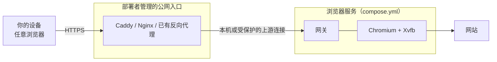

# Remote Claude Browser

在自己的服务器上运行一个真实的 Chromium，然后在任意设备的浏览器里使用它打开的网页，包括 Claude 的官方网页版。

网页的脚本、Cookie 和网络请求都留在服务器上。你的设备收到的是重建后的无脚本页面，所以文字依然清晰，可以选择、复制和查找；重建不了的内容可以切到实时画面操作。

基于 [Remote Browser](https://github.com/mystxcal/remote-browser)（Apache-2.0）修改，上游版本记录在 [UPSTREAM_COMMIT](UPSTREAM_COMMIT)，原始介绍保留在 [UPSTREAM.md](UPSTREAM.md)。

> 这是一个独立项目，与 Anthropic 没有关联，也未获其认可。Claude 是 Anthropic 的商标。你需要自己遵守所访问网站的服务条款。本项目不保证匿名，也不保证能通过任何网站的验证。

## 功能

- **页面模式**：无脚本的 DOM 镜像，低带宽，文字可选可复制，支持中文输入法
- **画面模式**：登录、验证码或复杂页面显示不全时，查看并操作真实的浏览器画面
- **独立用户**：用用户名和密码登录工作台；不同用户有各自的 Chrome 和浏览器配置，网站登录自由选择
- **多会话**：同一用户可以打开多个独立窗口、标签页和视口，也可以在 ⋯ 菜单里新建并选择自己的浏览器配置
- **指纹隔离**：每个浏览器配置有自己的屏幕尺寸、字体和字体渲染，网站看到的是不同的设备指纹；不往页面里加噪声，也不改写浏览器 API，检测站不会判为篡改或自动化。音频、WebGL 和 CPU 仍有同机特征；出口 IP 由各配置选择的节点决定
- **用户管理**：管理员可以创建、禁用、修改和删除前端用户，或重置其密码；身份和配置归属保存在 SQLite 中
- **手机可用**：触屏操作，可请求手机版网页
- **文件**：调起本机文件选择器上传；下载边传边存，不长期占用服务器磁盘
- **视频和语音**：页面里的视频通过 WebRTC 播放，声音和麦克风都在你自己的设备上
- **断线恢复**：刷新或重连后回到原来的会话，页面崩溃会自动恢复
- **代理与可选 API**：导入共享或私有代理来源，为每个浏览器配置明确选择出口；每个用户可以管理独立的 CPA 实例、Claude Code OAuth 凭据和外部 API Key，见 [CPA 部署](docs/cpa.md)

## 部署结构



| 部分       | 文件                                          | 作用                                                              |
| ---------- | --------------------------------------------- | ----------------------------------------------------------------- |
| 浏览器服务 | `compose.yml`                                 | 运行浏览器和网关，保存登录状态；HTTP 端口默认只发布到本机回环地址 |
| 入口示例   | [`examples/caddy/`](examples/caddy/README.md) | 同机和独立 VPS 的 Caddy 配置，按部署环境选择                      |
| 兼容模板   | `compose.https.yml`、`client/`                | 保留已有同机 Caddy、独立入口机和 SSH 隧道部署的文件路径           |

核心服务提供 HTTP 和 WebSocket。公网域名、TLS 证书、反向代理和跨主机连接由部署者管理，不要求单独部署“客户端”服务。

你的设备不需要安装任何东西，用浏览器打开入口地址即可。

## 快速开始

### 只想在本机试试

需要 Docker 和 Compose v2，服务端建议至少 2 核 4 GB 内存。

```bash
git clone https://github.com/NotDesigned/remote-claude-browser.git remote-claude-browser
cd remote-claude-browser
./scripts/bootstrap.sh
```

脚本会生成 `.env`（包含随机密码和密钥）、构建并启动服务，最后打印访问地址和初始密码。用浏览器打开 `http://127.0.0.1:3010`，以用户名 `admin` 和这个密码登录。打开远程浏览器前，还需启用下面的运行时模块、导入节点并给配置选择出口。

### 配置公网入口

把浏览器服务接到已有 Caddy、Nginx 或其他反向代理，并在 `.env` 中设置用户实际访问的 HTTPS 来源：

```bash
MIRROR_PUBLIC_ORIGIN=https://browser.example.com
```

```bash
docker compose up -d server
```

反向代理需转发 WebSocket 和流式响应。可直接参考[同机或独立 VPS 的 Caddy 示例](examples/caddy/README.md)。域名、证书和上游通道在部署层配置。

已有 `compose.https.yml` 或 `client/compose.yml` 的部署可以继续使用；具体用法和升级、备份见 [docs/deployment.md](docs/deployment.md)。

### 浏览器出口与可选用户 CPA

全新部署在浏览器服务上增加运行时模块：

```bash
docker compose -f compose.yml -f compose.runtime.yml up -d --build
```

长期使用时将 `compose.runtime.yml` 加入 `.env` 的 `COMPOSE_FILE`。已有部署保留原文件列表、数据卷和出站设置，在其后追加这个模块。

打开「代理与 API」即可导入代理来源、创建自己的 CPA 实例、授权 Claude 并生成外部调用 Key。浏览器卡片的 ⋯ →「设置出口」选择节点。空选项表示「未分配」，配置未选节点时不能新开、恢复或切入远程浏览器；添加 CPA 授权时默认使用当前浏览器配置的出口，可手动换节点；没有可用的当前出口时必须先选择。新的 OpenAI 兼容 Base URL 为 `/v1`，完整说明、旧独立 CPA 的兼容路由及备份见 [docs/cpa.md](docs/cpa.md)。

## 第一次使用

1. 打开入口地址，输入**前端用户名和密码**。首次启动的管理员默认名为 `admin`，密码来自 `.env` 的 `MIRROR_ACCESS_PASSWORD`；这与浏览器内网站的账号无关。
2. 登录后先选择浏览器配置，也可以新建配置；打开前通过卡片的 ⋯ →「设置出口」绑定节点。配置卡片显示 Claude 登录邮箱或“未登录”；站点明确停用的账号显示“账号不可用”。刷新已有会话会直接恢复，新登录或另开会话会重新选择配置。
3. 选择后打开远程窗口。需要登录网站时，建议切到顶部的“画面”模式操作，完成后切回“页面”。
4. 管理员可在 ⋯ 菜单的用户管理中建立其他用户。新用户从空白浏览器配置开始，不会得到管理员的网站 Cookie。
5. 用户、网站登录状态和配置归属保存在服务端的 `data` 卷里，重启和升级后依然有效。会话总上限默认 `8`，可通过 `MIRROR_CLIENTS` 设置为任意正整数。

邮箱在配置打开 Claude 后读取并保留，下次选择时直接显示；选择页会自动刷新状态。升级前从未读取过邮箱的旧配置，首次仍可能显示“已登录”，打开一次后即可更新。

进入会话后，可从右上角 ⋯ →「选择浏览器配置…」回到同一选择页；选择其他配置会切换当前会话，点「返回会话」则继续原来的页面。每张配置卡片右侧的 ⋯ 菜单可以重命名、设为默认或删除非默认配置。默认配置按用户保存并排在最前；删除正在使用的非默认配置后，本设备对应的会话会切回默认配置。其他设备正在使用的配置需要先在那边切换或结束会话。

升级旧版本时，原有浏览器配置全部归初始管理员，原设备需要重新用用户名和密码登录。已有数据库不会因为修改 `.env` 而重新设置用户密码。浏览器时区按所选出口自动确定，工作台时钟显示出口 GeoIP 的真实城市及当地时间，缺少城市时显示国家；见[时区说明](docs/timezone.md)。

## 安全须知

前端用户的浏览器配置和会话按身份隔离。同一用户选择同一个浏览器配置时，仍会共享其中的网站 Cookie、历史和网站账号权限。

- 公网访问必须走 HTTPS，并且 `SERVER_BIND` 保持 `127.0.0.1`。
- 浏览器以非 root 用户运行，沙箱保持开启。Chromium 的调试协议走进程内管道，不监听任何端口。
- 容器内的防火墙阻止网页访问私有网段、宿主机和云元数据地址。容器看不到宿主机的公网 IP，请把它填进 `EGRESS_BLOCK`。
- `data` 卷里有 Cookie 和登录令牌，要像对待密钥一样保护它和它的备份。
- 不同用户的 Chrome 仍在同一容器、同一系统用户下运行，共享服务器资源；这不是针对恶意租户设计的独立虚拟机边界。

详见 [docs/security.md](docs/security.md)。

## 文档

- [部署](docs/deployment.md)：浏览器服务、入口契约、兼容模板、升级与备份
- [Caddy 入口示例](examples/caddy/README.md)：同机反向代理或独立 VPS 入口
- [CPA 面板与 API](docs/cpa.md)：可选服务、OAuth、接口地址、Caddy 路由和出站隔离
- [配置](docs/configuration.md)：环境变量
- [架构](docs/architecture.md) · [安全](docs/security.md) · [排错](docs/troubleshooting.md)
- [双机 systemd 部署与运维](docs/operations.md)：不用 Docker 的部署方式和日常使用细节

## 开发

```bash
pnpm install --frozen-lockfile
pnpm build
pnpm typecheck
pnpm test
pnpm test:profiles-ui # 配置选择、状态刷新、新建、恢复和手机布局；使用本地测试页面
pnpm test:profiles-webkit # 使用 WebKit 再验收同一套流程，需先安装 Playwright WebKit 及运行依赖
pnpm smoke:compose   # 构建镜像并做端到端检查，需要 Docker，设置 CHROME_PATH 后还会真实登录一次
pnpm check:fingerprint [镜像] [账号数]   # 用临时容器开几个新浏览器配置，查看 who.1ms.dog 和 fingerprint.com 的判定
```

## 许可

[Apache-2.0](LICENSE)。第三方声明见 [NOTICE](NOTICE) 和 [THIRD_PARTY_NOTICES.md](THIRD_PARTY_NOTICES.md)。
