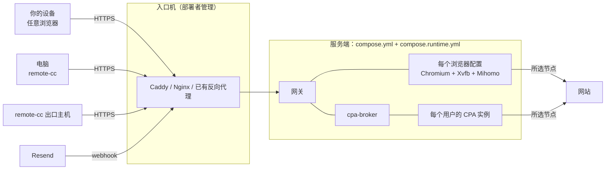

# Remote Claude Browser

> 读者：第一次来的人，以及正在评估是否部署的人

Remote Claude Browser（RCB）在你自己的服务器上运行真实的 Chromium，你在任意设备的浏览器里使用它打开的网页，包括 Claude 的网页版。

网页的脚本、Cookie 和网络请求都留在服务器上。你的设备默认用**页面模式**查看：收到的是重建后的无脚本页面，文字清晰，可以选择、复制和查找。页面模式显示不全的内容（登录、验证码、复杂页面）可以切到**画面模式**，直接查看和操作真实的浏览器画面。

本项目从[上游项目](https://github.com/mystxcal/remote-browser)（Apache-2.0）分叉而来，分叉时的上游提交记在 [UPSTREAM_COMMIT](UPSTREAM_COMMIT)，上游原始说明保存在 [UPSTREAM.md](UPSTREAM.md)。

> 这是一个独立项目，与 Anthropic 没有关联，也未获其认可。Claude 是 Anthropic 的商标。你需要自己遵守所访问网站的服务条款。本项目不保证匿名，也不保证能通过任何网站的验证。

## 功能

- **页面模式和画面模式**：页面模式低带宽、支持中文输入法；画面模式用于登录和验证码。见[使用](docs/usage.md)。
- **用户**：用用户名和密码登录工作台，也可以启用单点登录（OpenID Connect）；每个用户只看到自己的浏览器配置和会话，管理员在「管理后台」管理用户。见[管理](docs/admin.md)。
- **浏览器配置**：每个配置有独立的 Chrome 进程、网站登录资料、屏幕尺寸和字体；同一用户可以开多个会话。见[使用](docs/usage.md)。
- **系统身份**：每个配置可以「设置系统」；可选安装 AliasMode 内核。见[使用](docs/usage.md)和[部署](docs/deployment.md)。使用 AliasMode 时，Windows 和 Mac 的字体要由部署者自己准备，本项目不提供，见[部署 · AliasMode 内核](docs/deployment.md#aliasmode-内核)。
- **出口**：每个配置必须绑定一个节点，网页、DNS 和 WebRTC 都经这个节点出去；浏览器的当地时间跟随出口。见[使用](docs/usage.md)。
- **CPA**：每个用户可以有自己的 CPA 实例，用调用 Key 访问 `/v1`。见[使用 · CPA](docs/usage.md#cpa)。
- **收件箱**：通过 Resend 接收邮件，用于网站注册和验证。见[使用](docs/usage.md)。
- **「Apple 账户与 Claude 登录」**：在当前浏览器配置里引导注册账户并登录 Claude。见[使用](docs/usage.md)。
- **remote-cc 联动**：[remote-cc](https://github.com/NotDesigned/remote-cc) 可以用某个浏览器配置的 Claude 账号和出口运行 Claude Code。见[使用 · remote-cc](docs/usage.md#remote-cc)和[接口契约](docs/remote-cc.md)。
- **手机、文件、音视频、断线恢复**：支持触屏和手机版网页，上传和下载文件，页面里的视频和语音经 WebRTC 在你的设备上播放，刷新或断线后回到原来的会话。

## 部署结构



服务端只提供 HTTP 和 WebSocket，默认只发布到本机回环地址。域名、TLS 证书、反向代理和跨主机通道由部署者管理；入口机可以就是服务端本身。入口需要转发的路径见[部署 · 公网入口](docs/deployment.md#公网入口)，Caddy 配置见 [examples/caddy](examples/caddy/README.md)。

你的设备不需要安装任何东西，用浏览器打开入口地址即可。

## 快速开始

需要 Linux、Docker 和 Compose v2，服务端建议至少 2 核 4 GB 内存。完整要求见[部署](docs/deployment.md)。

```bash
git clone https://github.com/NotDesigned/remote-claude-browser.git
cd remote-claude-browser
COMPOSE_FILE=compose.yml:compose.runtime.yml ./scripts/bootstrap.sh
echo 'COMPOSE_FILE=compose.yml:compose.runtime.yml' >> .env
```

`bootstrap.sh` 生成 `.env`（随机密码和密钥），构建并启动服务，等健康检查通过后打印访问地址和初始密码。第二行命令把 `compose.runtime.yml` 记进 `.env`，以后的 `docker compose` 命令都会带上它；没有它，任何浏览器配置都打不开。

用浏览器打开 `http://127.0.0.1:3010`，用户名 `admin`，密码是脚本打印的那个。然后：

1. 在「代理与 API」→「代理来源」导入至少一个节点。
2. 在配置选择页点「新建浏览器配置」，填写名称、选择出口，再点「检查并打开」。已有的配置通过卡片的「⋯」→「设置出口」绑定节点。

每一步的细节见[使用](docs/usage.md)。要从公网访问，在 `.env` 里设置 `MIRROR_PUBLIC_ORIGIN=https://browser.example.com`，执行 `docker compose up -d`，再按[部署 · 公网入口](docs/deployment.md#公网入口)配置反向代理。其他 compose 组合见[部署 · 可用的 compose 组合](docs/deployment.md#可用的-compose-组合)。

## 文档

| 读者         | 文档                                                                                               | 内容                                                      |
| ------------ | -------------------------------------------------------------------------------------------------- | --------------------------------------------------------- |
| 使用者       | [docs/usage.md](docs/usage.md)                                                                     | 工作台、浏览器配置、出口、CPA、收件箱、remote-cc          |
| 工作台管理员 | [docs/admin.md](docs/admin.md)                                                                     | 「管理后台」、共享资源、停用和删除用户、批准出口主机      |
| 部署者       | [docs/deployment.md](docs/deployment.md)                                                           | 安装、compose 组合、公网入口、CPA、升级、备份、资源与超时 |
| 部署者       | [docs/configuration.md](docs/configuration.md)                                                     | 环境变量和构建参数                                        |
| 部署者       | [docs/troubleshooting.md](docs/troubleshooting.md)                                                 | 按症状排查                                                |
| 部署者       | [examples/caddy/README.md](examples/caddy/README.md)                                               | 同机和独立 VPS 的 Caddy 入口                              |
| 升级的部署者 | [CHANGELOG.md](CHANGELOG.md)                                                                       | 版本历史和升级步骤                                        |
| 接入方       | [docs/remote-cc.md](docs/remote-cc.md)                                                             | remote-cc 接口契约、令牌、会话授权                        |
| 安全审查     | [docs/security.md](docs/security.md)                                                               | 威胁模型和信任边界；漏洞报告见 [SECURITY.md](SECURITY.md) |
| 开发者       | [docs/architecture.md](docs/architecture.md)                                                       | 组件、数据流、不变量、决策                                |
| 开发者       | [CONTRIBUTING.md](CONTRIBUTING.md)                                                                 | 开发、测试、发布                                          |
| 写文档的人   | [docs/documentation.md](docs/documentation.md)                                                     | 文档规则、归属表、术语                                    |
| 维护者       | [docs/records/2026-11-03-resource-plane.md](docs/records/2026-11-03-resource-plane.md)             | 资源平面事故复盘                                          |
| 维护者       | [docs/records/2026-11-06-systemd-operations.md](docs/records/2026-11-06-systemd-operations.md)     | 双机 systemd 部署运维记录                                 |
| 维护者       | [docs/records/2026-11-16-aliasmode-evaluation.md](docs/records/2026-11-16-aliasmode-evaluation.md) | AliasMode 评测                                            |
| 维护者       | [docs/records/2026-11-16-windows-runtime.md](docs/records/2026-11-16-windows-runtime.md)           | Windows 浏览器运行端计划                                  |

## 许可

[Apache-2.0](LICENSE)。第三方声明见 [NOTICE](NOTICE) 和 [THIRD_PARTY_NOTICES.md](THIRD_PARTY_NOTICES.md)。
