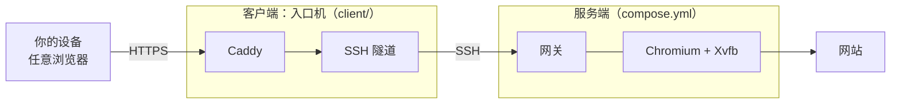

# Remote Claude Browser

在自己的服务器上运行一个真实的 Chromium，然后在任意设备的浏览器里使用它打开的网页，包括 Claude 的官方网页版。

网页的脚本、Cookie 和网络请求都留在服务器上。你的设备收到的是重建后的无脚本页面，所以文字依然清晰，可以选择、复制和查找；重建不了的内容可以切到实时画面操作。

基于 [Remote Browser](https://github.com/mystxcal/remote-browser)（Apache-2.0）修改，上游版本记录在 [UPSTREAM_COMMIT](UPSTREAM_COMMIT)，原始介绍保留在 [UPSTREAM.md](UPSTREAM.md)。

> 这是一个独立项目，与 Anthropic 没有关联，也未获其认可。Claude 是 Anthropic 的商标。你需要自己遵守所访问网站的服务条款。本项目不保证匿名，也不保证能通过任何网站的验证。

## 功能

- **页面模式**：无脚本的 DOM 镜像，低带宽，文字可选可复制，支持中文输入法
- **画面模式**：登录、验证码或复杂页面显示不全时，查看并操作真实的浏览器画面
- **多会话**：多个独立窗口、标签页和视口，共用一个浏览器配置，登录一次即可
- **手机可用**：触屏操作，可请求手机版网页
- **文件**：调起本机文件选择器上传；下载边传边存，不长期占用服务器磁盘
- **视频和语音**：页面里的视频通过 WebRTC 播放，声音和麦克风都在你自己的设备上
- **断线恢复**：刷新或重连后回到原来的会话，页面崩溃会自动恢复

## 部署结构



| 部分   | 文件                 | 作用                                                                   |
| ------ | -------------------- | ---------------------------------------------------------------------- |
| 服务端 | `compose.yml`        | 浏览器、网关和登录状态都在这里，端口默认只绑定本机回环地址             |
| 客户端 | `client/compose.yml` | 对外的入口：自动申请 HTTPS 证书，通过 SSH 隧道转发到服务端，不跑浏览器 |
| 单机   | `compose.https.yml`  | 只有一台机器时用，把 Caddy 和服务端放在一起                            |

你的设备不需要安装任何东西，用浏览器打开入口地址即可。

## 快速开始

### 只想在本机试试

需要 Docker 和 Compose v2，服务端建议至少 2 核 4 GB 内存。

```bash
git clone https://github.com/NotDesigned/remote-claude-browser.git remote-claude-browser
cd remote-claude-browser
./scripts/bootstrap.sh
```

脚本会生成 `.env`（包含随机密码和密钥）、构建并启动服务，最后打印访问地址和密码。用浏览器打开 `http://127.0.0.1:3010`，输入密码即可。

### 一台服务器，带 HTTPS

把域名解析到这台机器，然后：

```bash
./scripts/bootstrap.sh
docker compose down
```

编辑 `.env`，设置这两项：

```bash
PUBLIC_HOST=browser.example.com
MIRROR_PUBLIC_ORIGIN=https://browser.example.com
```

```bash
docker compose -f compose.yml -f compose.https.yml up -d
```

### 服务端和入口机分开

见 [docs/deployment.md](docs/deployment.md)。

## 第一次使用

1. 打开入口地址，输入**访问密码**。它是这个服务自己的密码，不是任何网站的账号密码。
2. 服务会打开一个远程窗口。需要登录网站时，建议切到顶部的“画面”模式操作，完成后切回“页面”。
3. 登录状态保存在服务端的 `data` 卷里，重启和升级后依然有效。

## 安全须知

**任何拿到访问密码的人，都能使用这个浏览器里所有已登录的账号。** 所有会话共用一个浏览器配置，这个项目不适合多租户场景。

- 公网访问必须走 HTTPS，并且 `SERVER_BIND` 保持 `127.0.0.1`。
- 浏览器以非 root 用户运行，沙箱保持开启。Chromium 的调试协议走进程内管道，不监听任何端口。
- 容器内的防火墙阻止网页访问私有网段、宿主机和云元数据地址。容器看不到宿主机的公网 IP，请把它填进 `EGRESS_BLOCK`。
- `data` 卷里有 Cookie 和登录令牌，要像对待密钥一样保护它和它的备份。

详见 [docs/security.md](docs/security.md)。

## 文档

- [部署](docs/deployment.md)：服务端、入口机、升级与备份
- [配置](docs/configuration.md)：环境变量
- [架构](docs/architecture.md) · [安全](docs/security.md) · [排错](docs/troubleshooting.md)
- [双机 systemd 部署与运维](docs/operations.md)：不用 Docker 的部署方式和日常使用细节

## 开发

```bash
pnpm install --frozen-lockfile
pnpm build
pnpm typecheck
pnpm test
pnpm smoke:compose   # 构建镜像并做端到端检查，需要 Docker，设置 CHROME_PATH 后还会真实登录一次
```

## 许可

[Apache-2.0](LICENSE)。第三方声明见 [NOTICE](NOTICE) 和 [THIRD_PARTY_NOTICES.md](THIRD_PARTY_NOTICES.md)。
