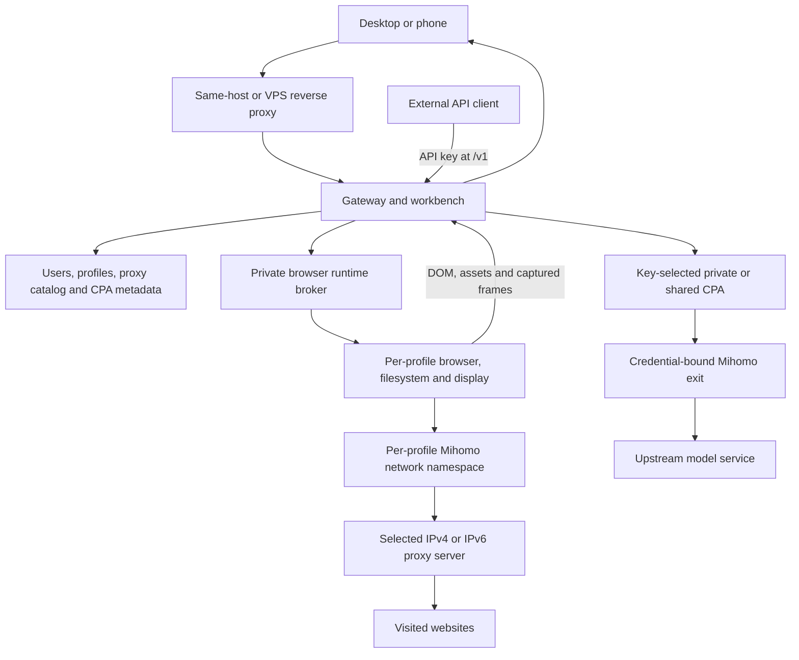
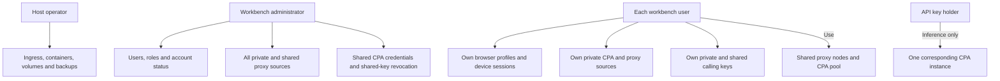
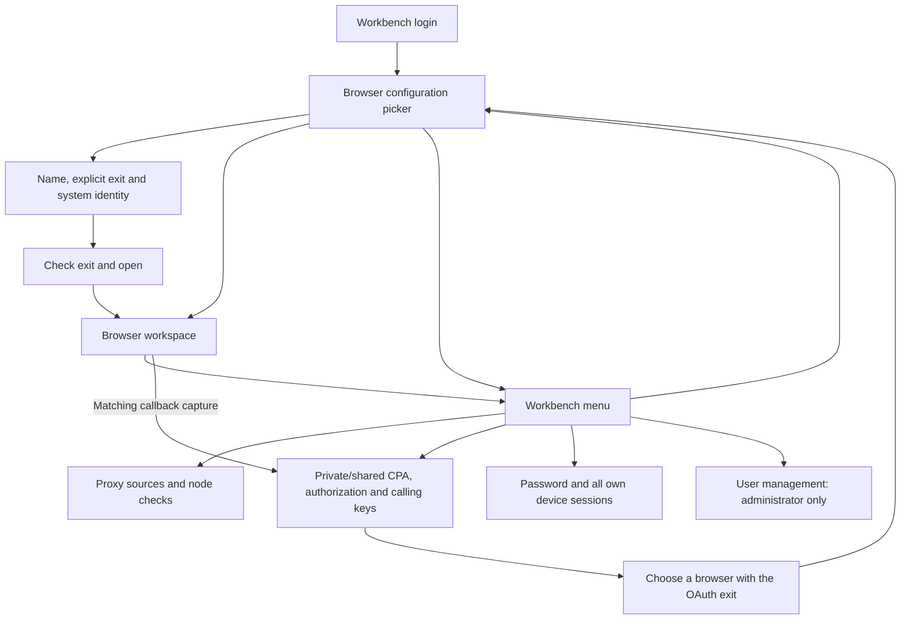

# Architecture

The gateway serves one workbench for browser configurations, proxy sources and CPA. The browser
executes visited-site scripts and owns website cookies. The viewer reconstructs its pages or shows
its captured display. Public ingress is configured by the deployer.

## System flow

Each profile owns a browser process, profile directory, private authenticated Xvfb display, network,
mount and PID namespaces. Same-profile sessions share website login and fingerprint identity,
while owning separate windows. Profiles still share the container, kernel, CPU, memory and disk.
The optional AliasMode engine supplies Windows, macOS or Linux identities on the Linux runtime;
it does not create a Windows or macOS VM.

The root broker exposes fixed browser/network operations on a private Unix socket. Chrome runs
as UID 10001 with its sandbox enabled and a private CDP pipe. Browser filesystems expose their own
profile, display, temporary storage, `/proc` and read-only dependencies. Other profiles, service
databases and management sockets are absent. HTTP, HTTPS and `about:blank` are accepted navigation
schemes; native file navigation is blocked.

Mihomo may connect to proxy servers over IPv4 or IPv6. Browser traffic, DNS, WebRTC and gateway
asset downloads use the selected exit. Browsers cannot use the upstream IPv6 link directly.
An unassigned or failed exit blocks startup; it never selects another node or deployment default.
Deployment-level Xray remains available for legacy service traffic, separately from profile exits.

## Ownership and management

Profile operations require ownership. Session control additionally requires the current device;
“My account” can list and end that user's sessions across devices. Workbench administrators have
no direct cross-user profile or private CPA access. Private proxy sources are an explicit exception:
their owner and administrators may use and manage them. Administrators can reset workbench
passwords; host operators can access persistent data and remain trusted.

Every enabled user may own one private CPA and issue keys for the shared CPA. Administrators
manage the shared instance and its credentials, and may revoke any shared key. External keys
select an instance by their stored digest; they grant no management access. All instances use the
same `/v1` path. Browser cookies, Claude OAuth credentials and external calling keys are separate.
CPA containers have distinct configuration/auth/static volumes, no published ports, and only an
internal network. A fixed broker manages their containers and volumes. Each credential uses its
own explicitly bound exit; unbound credentials are disabled. Adding OAuth does not stop existing
inference, and the selected OAuth proxy is saved with the new credential before it becomes usable.

Disabling a user revokes workbench logins, closes sessions and stops the private CPA, retaining
profiles, credentials and keys for re-enabling. The private CPA then needs an explicit start.
“Delete user and data” permanently removes that user's profiles, private proxy sources, private CPA
container/volumes and calling keys. Shared resources and other users remain. Cleanup failure leaves
the user disabled so deletion can be retried. The last enabled administrator cannot be disabled or
deleted, and an administrator cannot delete their own account.

## Frontend flow

Profile card menus contain exit/system settings, exit checks, rename, default and deletion. Default
profiles cannot be deleted. Same-name profiles remain separate IDs. Cards distinguish connected
sessions from sleeping records and show whether the browser process is running.

Proxy and API sections retain their forms when switched. OAuth callback drafts are scoped by user,
instance and OAuth state in tab session storage, surviving profile selection and page reloads.
Submitting, completing or cancelling that authorization clears its draft. Full newly issued API
keys are never persisted and disappear when leaving the API section. OAuth selection only lists
profiles bound to its chosen node; selecting one opens the saved authorization without changing any
existing profile's exit. Mobile uses the same navigation with single-column management panels.

## Browser data and recovery

The agent records rrweb snapshots and ordered mutations in each document. An isolated-world CDP
bridge transports them to the tab hub; authenticated WebSockets deliver snapshots and deltas to the
viewer. Input uses node IDs and relative coordinates, resolves the authoritative node and dispatches
trusted CDP input. Passwords remain masked; local editing echo is reconciled with the remote page.
The scriptless replay iframe inherits CSP blocking visited-site scripts, forms, popups and local
navigation. This is a markup/CSS/font parsing boundary, not pixel-only isolation.

Resource URLs are encrypted, runtime/session-bound gateway tokens. Rewrites carry each document's
own URL and base, including embedded frames. Fetches use that frame's browser context or the same
exit with browser cookies, UA and a normal Referer. Range/fallback HTTP/TLS pools are per-session;
release destroys them. Private/link-local destinations are blocked in both address families.
WebRTC signaling stays in isolated worlds. Pixel mode captures X11 including native menus, with
CDP screencast as its fallback, and keeps the DOM recorder running.

There is no fixed session count limit. New or resumed windows require available memory, and a new
profile reserves additional browser/display headroom. Each user may save eight profiles. Hidden
viewer tabs disconnect; their windows can be reclaimed on the next sweep. Unexpected disconnects
have a 60-second grace. Active generation and matching CPA authorization defer reclamation.
A profile with no active session closes its browser after 120 seconds. Persistent website login
survives; dormant window recovery restores URLs rather than unsaved page/form state.

Slow viewers, sequence gaps or replay errors request a fresh snapshot. Renderer crashes use bounded
reload recovery. Exit errors distinguish connection, DNS, timeout, upstream HTTP and invalid location
data, without returning proxy credentials or internal diagnostics to the client.
