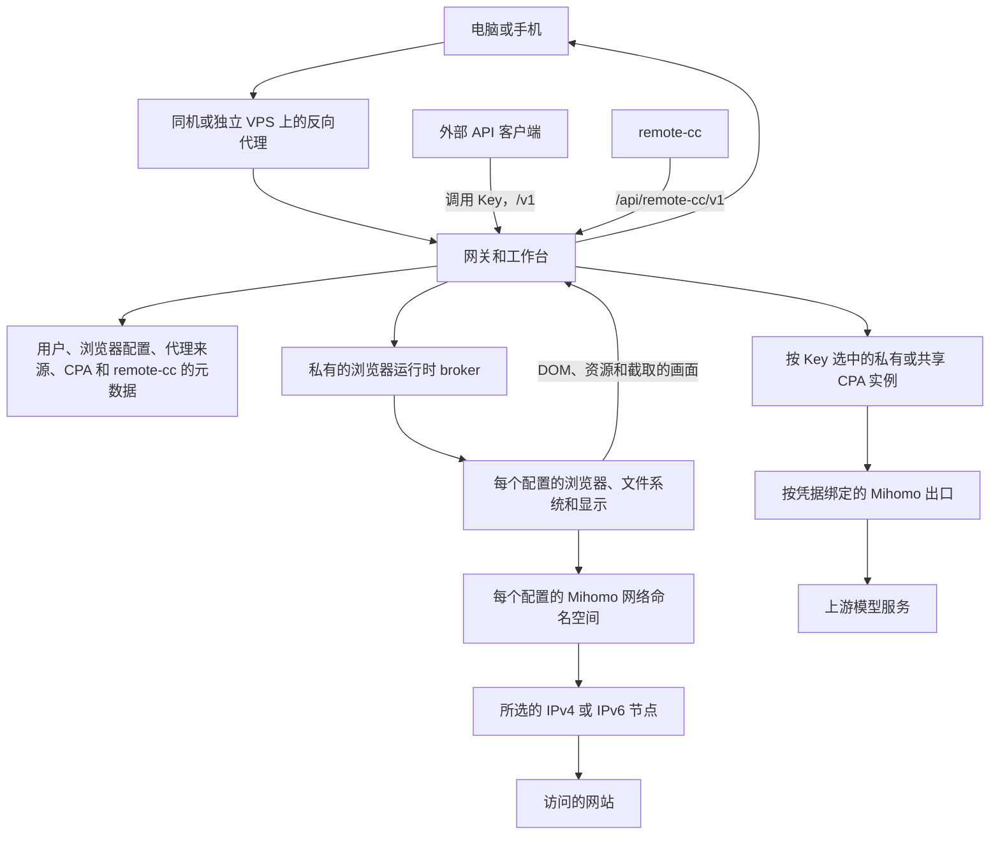
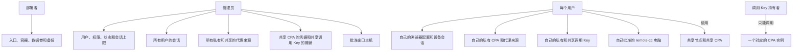

# 架构

> 读者：开发者

网关提供一个工作台，管理浏览器配置、代理来源和 CPA。浏览器执行所访问网站的脚本并持有网站 Cookie；查看端重建它的页面，或显示它的画面。公网入口由部署者配置。

## 组件和数据流

| 包或目录            | 作用                                                                     |
| ------------------- | ------------------------------------------------------------------------ |
| `packages/gateway`  | 网关：登录、会话、浏览器生命周期、资源代理、出口、CPA、收件箱、remote-cc |
| `packages/viewer`   | 查看端：工作台界面、页面模式的回放、画面模式                             |
| `packages/agent`    | 注入远程页面的采集脚本（rrweb 快照和增量）                               |
| `packages/protocol` | 网关、查看端和采集脚本之间的消息格式                                     |
| `deploy/`           | 镜像、入口脚本、运行时 broker、`cpa-broker`、出口和防火墙脚本            |
| `client/`           | 独立入口机的 Caddy 和 SSH 隧道                                           |

## 浏览器配置和运行时

每个浏览器配置有自己的浏览器进程、配置目录、带认证的私有 Xvfb 显示，以及网络、挂载和 PID 命名空间。同一配置的多个会话共享网站登录和系统身份，各自有独立的窗口。所有配置共享容器、内核、CPU、内存和磁盘。

一个以 root 运行的 broker 在私有的 Unix socket 上提供固定的浏览器和网络操作。Chrome 以 UID 10001 运行，沙箱开启，经私有的 CDP 管道控制。浏览器的文件系统里只有它自己的配置目录、显示、临时存储、`/proc` 和只读的依赖。

Mihomo 可以用 IPv4 或 IPv6 连接节点。浏览器流量、DNS、WebRTC 和网关代为下载的资源都走所选出口；浏览器不能直接使用上游的 IPv6。没有绑定或出口故障时浏览器不启动，不会改选别的节点。

**时区**：打开配置时，经这个配置的 Mihomo 查询一个 GeoIP 服务，从同一个响应里取出口 IP、城市、国家和 IANA 时区，并记进配置记录。Chrome 以这个时区启动；工作台的时钟用服务器的 UTC 样本校准。CPA 的每个凭据同样按所选节点记下时区，CPA 用它生成请求里的当地日期。

**系统身份**：每个配置保存独立的指纹种子、屏幕尺寸、字体子集和字体渲染，不加 canvas 或音频噪声。可选的 AliasMode 内核在 Linux 上提供 Windows、macOS 和 Linux 身份，它不是 Windows 或 macOS 虚拟机。重命名、休眠重启、改出口、轮换 `MIRROR_AUTH_SECRET` 都不会重新生成种子。

## 页面模式和资源

采集脚本在每个文档里记录 rrweb 快照和有序的增量，经隔离环境里的 CDP 桥送到网关，再经认证的 WebSocket 送到查看端。采集脚本替换的浏览器内置函数看起来和原生的一样，采集时不往页面里插入节点，跨域 frame 之间的消息不带固定的名字；页面还能察觉的几项列在[威胁模型 · 页面能否察觉](security.md#页面能否察觉)（`MIRROR_AGENT_HARDENING=0` 退回旧行为）。

输入使用节点 id 和相对坐标，由网关找到权威节点。目前只有一部分是浏览器的可信输入（页面看到 `isTrusted: true`）：按键、`text` 插入文字、输入法组字和上屏、指针（点击、拖动、滚轮），以及向上滚动前网关发出的一次滚轮。另一部分由采集脚本在页面里完成，页面看到的是脚本行为：contenteditable 输入框的文字同步（`value` 消息，用 `execCommand("insertText")` 写入，没有 `keydown`/`beforeinput`）、取值控件（复选框、下拉框、日期等，设值后派发非可信的 `input`/`change`/`click`），以及滚动到精确位置（`scrollTo`）。P1 计划把所有文字改为由工作台本地的代理输入框经可信的 CDP 输入发出，回放只读。密码保持遮盖。查看端的回放 iframe 继承的 CSP 阻止网站脚本、表单、弹窗和本地导航；这是标记、CSS 和字体解析的边界，不是纯像素的隔离。

资源 URL 是加密的网关令牌，绑定运行实例和会话。重写时带上每个文档自己的 URL 和 base，包括嵌入的 frame。每个标签页在构造时就装好自己的资源重写器，并对资源 URL 做有上限的记忆，重复的图片和重新快照复用同一个网关 URL。抓取用该 frame 的浏览器网络上下文；浏览器取不到时默认返回 502，不改用网关自己的 HTTP 客户端（它的 TLS 特征和浏览器不同），只有 Range 请求由网关直接下载（`MIRROR_ASSET_DIRECT_FALLBACK`）。object URL 从它所在的浏览器上下文分段读取。CSS 是一张资源图：导入、字体和图片都相对样式表解析，并经同一个网关。Range 和回退用的 HTTP/TLS 连接池按会话隔离，会话释放时销毁。

画面模式截取配置的 X11 显示，包括原生菜单，以 CDP 截屏为后备，并保持 DOM 采集继续运行。WebRTC 信令留在隔离环境里。

## 会话和恢复

会话没有全局数量上限；新建和恢复按可用内存准入，打开新的配置还要预留浏览器和显示的内存。查看端标签页隐藏时断开；离线的会话有宽限期，期间正在生成回复或进行 CPA 授权会推迟回收；没有会话使用的配置在空闲一段时间后关闭浏览器。具体数值见[部署 · 资源与超时](deployment.md#资源与超时)。网站登录持久保存；休眠会话恢复的是网址，不是未保存的页面和表单状态。

查看端过慢、序号缺口或回放出错时请求新快照。渲染进程崩溃时有限次数地重载恢复。出口错误区分连接、DNS、超时、上游 HTTP 和无效的地理数据，不把代理凭据或内部诊断返回给客户端。

## 归属和权限

浏览器配置的操作要求归属；会话控制还要求是当前设备。管理员不能直接访问其他用户的浏览器配置和私有 CPA；私有代理来源是例外，所有者和管理员都能使用和管理。停用和删除用户的效果见[管理](admin.md#停用和删除用户)。

CPA 容器各有配置、授权和面板卷，不发布端口，只连接内部网络，由一个只接受固定模板的 `cpa-broker` 管理。每个凭据使用自己明确绑定的出口；新增的授权在可用之前就保存了所选节点。调用 Key 按存储的摘要选中实例，不带任何管理权限。

**登录**：用户名和密码登录发放不透明的令牌，数据库只存摘要。单点登录（OIDC）按 issuer 加 `sub` 把外部身份对应到本地用户，可以自动创建用户，也可以绑定到已有用户；两种方式最后都发放同一种工作台登录。

**remote-cc**：工作台只通过 `/api/remote-cc/v1` 和 remote-cc 联系，契约见[接口契约](remote-cc.md)。

## 不变量

- 浏览器配置没有绑定节点就不启动，任何路径都不回退到宿主机的地址或别的节点。
- CDP 不对外发布；Chromium 以非 root 运行并保持沙箱。
- 所有 `@rrweb/*` 包使用同一个精确版本。
- 资源令牌绑定运行实例；运行实例变化后旧令牌失效。
- 查看端不执行网站脚本。
- 网关不持有 Docker socket。

## 决策

- **语义 DOM 而不是纯像素**：页面模式传输重建的页面，文字清晰、可选择、带宽低，支持本机输入法。代价是标记和样式会进入查看端，所以保留画面模式给验证码和重建不了的页面。
- **每个配置一个出口，没有默认出口**：网站把出口 IP 和账号关联，静默回退到另一个出口比打不开更糟。所以未绑定的配置和凭据直接拒绝。
- **按出口确定时区**：网站会对比 IP 地理位置和浏览器时区。时区跟随出口，而不是部署者或使用者设备的时区。
- **同一容器里的命名空间隔离，而不是每个配置一个容器或虚拟机**：在有限内存的单机上能运行更多配置，并保持现有的 Chromium 和数据布局。代价是共享内核和系统 UID，见[威胁模型](security.md)。
- **原样运行 CPA，由固定模板的 broker 创建容器**：不修改上游 CPA，网关也不持有 Docker socket，只能请求固定的实例操作。
- **直接运行 AliasMode 内核**：保留现有的托管和隔离方式，不依赖反检测浏览器厂商的账号和 API。评测见 [2026-11-16 AliasMode 评测](records/2026-11-16-aliasmode-evaluation.md)。
- **资源重写在标签页构造时装好**：入口漏装重写器曾让原始图片 URL 直接到达查看端，所以重写不是可选的集成点。复盘见 [2026-11-03 资源平面](records/2026-11-03-resource-plane.md)。
- **单点登录按 issuer 加 `sub` 识别**：邮箱可以在身份提供方被改动或重复使用，不能作为身份。

其他记录：[2026-11-16 Windows 浏览器运行端计划](records/2026-11-16-windows-runtime.md)、[2026-11-06 双机 systemd 部署运维记录](records/2026-11-06-systemd-operations.md)。
